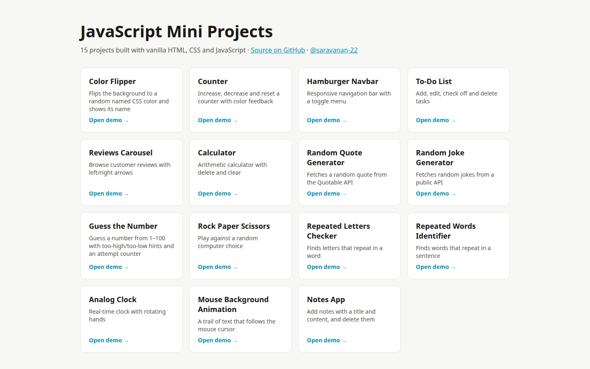

# JavaScript Mini Projects

15 small, interactive projects built with **vanilla HTML, CSS and JavaScript** — no frameworks — while learning DOM manipulation, events, timers and browser APIs.

**▶ Live gallery: [https://saravanan-22.github.io/javascript-mini-projects](https://saravanan-22.github.io/javascript-mini-projects/)**



| # | Project | What it does | Demo | Code |
|---|---|---|---|---|
| 1 | **Color Flipper** | Flips the background to a random named CSS color and shows its name | [Live](https://saravanan-22.github.io/javascript-mini-projects/color-flipper/) | [`color-flipper/`](color-flipper/) |
| 2 | **Counter** | Increase, decrease and reset a counter with color feedback | [Live](https://saravanan-22.github.io/javascript-mini-projects/counter/) | [`counter/`](counter/) |
| 3 | **Hamburger Navbar** | Responsive navigation bar with a toggle menu | [Live](https://saravanan-22.github.io/javascript-mini-projects/hamburger-navbar/) | [`hamburger-navbar/`](hamburger-navbar/) |
| 4 | **To-Do List** | Add, edit, check off and delete tasks | [Live](https://saravanan-22.github.io/javascript-mini-projects/todo-list/) | [`todo-list/`](todo-list/) |
| 5 | **Reviews Carousel** | Browse customer reviews with left/right arrows | [Live](https://saravanan-22.github.io/javascript-mini-projects/reviews-carousel/) | [`reviews-carousel/`](reviews-carousel/) |
| 6 | **Calculator** | Arithmetic calculator with delete and clear | [Live](https://saravanan-22.github.io/javascript-mini-projects/calculator/) | [`calculator/`](calculator/) |
| 7 | **Random Quote Generator** | Fetches a random quote from the Quotable API | [Live](https://saravanan-22.github.io/javascript-mini-projects/random-quote-generator/) | [`random-quote-generator/`](random-quote-generator/) |
| 8 | **Random Joke Generator** | Fetches random jokes from a public API | [Live](https://saravanan-22.github.io/javascript-mini-projects/random-joke-generator/) | [`random-joke-generator/`](random-joke-generator/) |
| 9 | **Guess the Number** | Guess a number from 1–100 with too-high/too-low hints and an attempt counter | [Live](https://saravanan-22.github.io/javascript-mini-projects/guess-the-number/) | [`guess-the-number/`](guess-the-number/) |
| 10 | **Rock Paper Scissors** | Play against a random computer choice | [Live](https://saravanan-22.github.io/javascript-mini-projects/rock-paper-scissors/) | [`rock-paper-scissors/`](rock-paper-scissors/) |
| 11 | **Repeated Letters Checker** | Finds letters that repeat in a word | [Live](https://saravanan-22.github.io/javascript-mini-projects/repeated-letters-checker/) | [`repeated-letters-checker/`](repeated-letters-checker/) |
| 12 | **Repeated Words Identifier** | Finds words that repeat in a sentence | [Live](https://saravanan-22.github.io/javascript-mini-projects/repeated-words-identifier/) | [`repeated-words-identifier/`](repeated-words-identifier/) |
| 13 | **Analog Clock** | Real-time clock with rotating hands | [Live](https://saravanan-22.github.io/javascript-mini-projects/analog-clock/) | [`analog-clock/`](analog-clock/) |
| 14 | **Mouse Background Animation** | A trail of text that follows the mouse cursor | [Live](https://saravanan-22.github.io/javascript-mini-projects/mouse-background-animation/) | [`mouse-background-animation/`](mouse-background-animation/) |
| 15 | **Notes App** | Add notes with a title and content, and delete them | [Live](https://saravanan-22.github.io/javascript-mini-projects/notes-app/) | [`notes-app/`](notes-app/) |

## Run locally

```bash
git clone https://github.com/saravanan-22/javascript-mini-projects.git
cd javascript-mini-projects
# open any project folder's index.html in your browser
```

## Tech
HTML5 · CSS3 · JavaScript (ES6) · DOM API · Fetch API

## License
[MIT](LICENSE) © Saravanan
